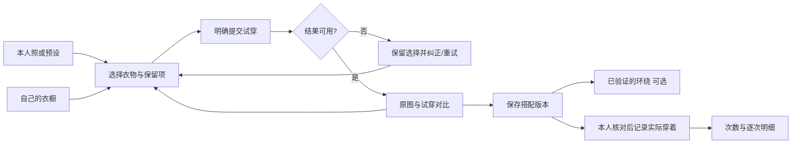

# 功能需求与交互

更新：2026-10-13。产品方向来自 C-01～04；优先级为研究后的建议，尚非开发排期。P0 是小范围真实试用的 Must，P1 是 Should，P2 是 Could，Out 是当前 Won't。试穿先经过 06 的技术与效果门槛，不能把 P0 写成已可用。本轮只维护文档。

保留已有 FR 编号，不复用已移出的编号。每条验收列均为期望结果；现状差距与首版取舍见 [07](07-MVP范围与实现差距.md)，阶段验收见 06。衣物规则见 04，系统和非功能合同见 05。

## 1. 衣橱与搭配基础

| ID    | 优先级 | 功能要求                                       | 验收结果                                                               |
| ----- | ------ | ---------------------------------------------- | ---------------------------------------------------------------------- |
| FR-01 | P0     | 私人工作区和访问保护                           | 不同用户不能访问彼此的单品/人像/结果；预设演示不带入私人资产           |
| FR-02 | P0     | 手工录入真实衣物，最少名称与类别；可先无照片   | 可单独完成保存；不以 AI、价格、品牌、身材数据为必填                    |
| FR-03 | P0     | 上传、预览、裁剪、补换图；保留原图与衍生图关系 | 失败保留输入；同件换图不增库存/次数；实际格式及大小验证，边界见 CL-04  |
| FR-04 | P0     | 编辑、分类筛选、名称搜索与分页                 | 搜索覆盖用户全库而非当前加载页；无结果与加载失败分开；修改前后版本明确 |
| FR-05 | P0     | 拥有/参考、可用/洗涤/外借、活动/归档分开       | 默认只从自己拥有且可用的衣物选穿；状态不混入分类；详情可纠正           |
| FR-06 | P0     | 归档与恢复                                     | 退出新默认选衣，不删除历史实穿；恢复后原 ID 不变                       |
| FR-07 | P0     | 按穿着位置选衣、平铺清单与单件替换             | 换上衣只改对应项；连衣装与上下分体冲突有提示；未识别原衣物保持“未关联” |
| FR-08 | P0     | 保存搭配及版本；结果关联固定版本               | 编辑另存版本；旧结果不被重新解释成新选择；保存失败保留草稿             |
| FR-24 | P0     | 无图/处理失败的可用回退                        | 衣橱、手动搭配与记录仍可用；二维清单不命名为已生成试穿                 |
| FR-25 | P0     | 导出、删除、处理进度                           | 衣物/搭配/记录关联可读；私人媒体按授权导出；清理未完成不声称完全删除   |
| FR-26 | P0     | 中文、响应式、键盘与辅助技术                   | 核心操作能在窄屏与键盘完成；拖动对比/环绕有按钮替代；状态不只靠颜色    |

## 2. 核心人物试穿

| ID    | 优先级       | 功能要求                                   | 验收结果                                                                                  |
| ----- | ------------ | ------------------------------------------ | ----------------------------------------------------------------------------------------- |
| FR-40 | P0           | 本人照片与至少一个授权预设入口             | 区分“我的照片”“预设示例”；输入质量/权利说明清楚；不强制上传本人照片才能用衣橱             |
| FR-41 | P0           | 人物为主展示，单品选择、保留项与待改项清楚 | 看得见完整人物；选择变化即时反映在清单，原图不伪装成变化后的结果                          |
| FR-42 | P0           | 用有效人物输入与支持的真实衣物做单件试穿   | 在明示支持范围内保留人物身份、姿势及未替换衣物；输入/输出可对应；通过 NFR-09 才算视觉可用 |
| FR-43 | P0           | 提交、等待、恢复任务与状态查看             | 双击一次任务；刷新能找回；真实阶段无假百分比；结果返回与输入版本一致                      |
| FR-44 | P0           | 失败解释、有限重试、停止等待               | 分类说明输入问题/服务失败/未知状态/额度不足；保留选择；取消不能保证供应商停止时明确说明   |
| FR-45 | P0           | 原图与结果对比、查看细节、返回调整         | 桌面并排/滑动，手机可切换；同一人物比例和可比较构图；滑动不改变生成内容；图片失败有回退   |
| FR-46 | P0           | 保存可复用 Look，绑定人像/单品/结果版本    | 保存搭配不加次数；结果图缺失仍能查看清单；样例与自己衣物不可混淆                          |
| FR-47 | 独立验证门槛 | 已保存 Look 可拖动连续环绕                 | 必须逐帧与首尾一致性、设备交互均通过；四张离散图不称连续 360°；首发是否必需由 D-02 决定   |
| FR-48 | P1           | 外套叠穿、多件同时替换                     | 分品类/层次测试后开放；不能由单上衣成功推断多件均可用                                     |
| FR-49 | P1           | 结果质量反馈与版本回看                     | 能选“人物变了/衣服不对/其他部位被改/画面破损/不喜欢”；技术成功和用户接受分别记录          |

FR-42 指生成衣物的视觉预览，不是尺码预测。先验证上衣与下装单件替换，鞋/包/配饰与外套叠穿的试穿能力按 CL-03 逐项开放。预设人物上的效果不能宣传为本人真实合身效果。

## 3. 保存后的记录与统计

| ID    | 优先级 | 功能要求                             | 验收结果                                                         |
| ----- | ------ | ------------------------------------ | ---------------------------------------------------------------- |
| FR-12 | P1     | 给搭配安排日期/场景计划              | 未来计划、取消/未穿都不计实穿；没有计划也能记录                  |
| FR-13 | P0     | 从搭配或直接创建实际穿着记录         | 提交前核对日期、时区和单品；必须明确确认；未关联原衣物可保持未知 |
| FR-14 | P0     | 部分记录、同日多次、补录             | 同事件同件一次；同日真实两次可为两事件；未来日期不能记实穿       |
| FR-15 | P0     | 编辑、删除、防重、版本冲突           | 重试不多记；改 A/B 为 A/C，B 减一 C 加一；冲突不丢草稿           |
| FR-16 | P1     | 日历及列表区分计划/实际              | P0 至少提供记录列表；P1 日历支持同日多条；空日显示无记录         |
| FR-17 | P0     | 单品已记录次数、天数、最近日期与明细 | 与有效实穿重算相等；漏记不当成从没穿过；能进入对应记录           |
| FR-18 | P1     | 衣橱总量、结构、常穿/低频、日期窗口  | 分母与范围明确；归档/未知分开；低频不能自动认定闲置              |
| FR-30 | P1     | 价格/币种与每次穿着成本              | 未知≠0；不同币种不直接相加；次数为零不除零；口径遵循 04          |
| FR-31 | P1     | 草稿恢复与可关闭提醒                 | 草稿不计数；提醒不能自动确认实穿；私人图片不长期裸存本地缓存     |
| FR-38 | P1     | OOTD 照片关联与核对                  | 旧照不自动成为今天实穿；照片可不加记录，记录也可无照片           |

## 4. 增强能力与排除项

| ID    | 优先级 | 功能要求                                   | 验收结果                                                  |
| ----- | ------ | ------------------------------------------ | --------------------------------------------------------- |
| FR-09 | P1     | 推荐条件：日期/时区、场景、冷热、雨天/步行 | 显示实际使用条件，不要求精确定位或本人照                  |
| FR-10 | P1     | 从真实可用衣服提出至多 3 套候选            | item ID 均可反查；不足不凑数，无解说明缺口                |
| FR-11 | P1     | 推荐理由、锁定单品、局部替换               | 不改变锁定项；未知属性不当已满足；替换后重新校验          |
| FR-27 | P1     | 自动抠图/属性建议与批量录入                | 能逐项纠正，批量部分失败可恢复；不覆盖本人已确认属性      |
| FR-28 | P1     | 天气接入与城市级信息                       | 有更新时间/地点；失败可手选条件，不阻断记录               |
| FR-29 | P2     | 个性化排序与低频探索                       | 有反馈与可测收益后再上；优先保证可穿和约束正确            |
| FR-32 | P1     | 旅行/胶囊及组合复用                        | 与原单品/搭配版本关联，不复制实穿次数                     |
| FR-39 | P1     | 从穿搭照片识别候选衣物并匹配已有单品       | 本人确认后才入库；相似图不自动合并；未知背面不当实物证据  |
| FR-50 | P2     | 更多预设人物、可选分享与动作               | 先确认使用需求/资产权利；分享需明确对象和范围，默认不公开 |

Out：商城、广告、社区内容流、私信、多人衣橱、专业造型师交易、自动购买、自动推断实穿、任意上传模型、精确尺码/物理合身保证。暂不预建这些系统。

## 5. 核心流程与页面职责

| 触点          | 主任务                         | 必需状态                                              |
| ------------- | ------------------------------ | ----------------------------------------------------- |
| 试衣间        | 看人物、挑衣服、明确提交       | 示例/本人、空衣橱、无图、不支持、已选但未生成、运行中 |
| 对比结果      | 判断变化、再换一件、保存       | 输入版本、图片加载失败、旧结果、质量问题、保存失败    |
| 衣橱/单品详情 | 找衣服、改属性、看实际使用     | 空库/无结果/失败、不可用、归档、未确认属性            |
| 搭配收藏      | 再次打开、引用衣服、安排或记录 | 缺失资产、已归档单品、历史版本                        |
| 实穿记录/统计 | 核对事实、补录纠错、反查数字   | 无记录、部分记录、多次/同日、冲突、统计更新中         |
| 设置          | 私人资料与数据控制             | 导出/清理中、失败、第三方清理结果未确认               |

页面可以合并，不按功能条数新增路由。具体布局沿用最新版 Figma 与 DESIGN。业务操作的清晰度优先于增加效果开关。

## 6. 必须保持的交互语义

1. **选择与生成分开**：选衣更新草稿；点击“生成试穿”才提交。不能每点一件自动产生费用。
2. **固定比较基线**：一次结果对应一个人物输入、衣物选择版本和生成任务。继续修改后提示当前结果来自旧选择；返回旧任务不覆盖新草稿。
3. **保存与实穿分开**：“保存搭配”“安排日期”“记录实际穿着”分别命名。生成、浏览、收藏、环绕和日期到达均不计数。
4. **原人物已穿衣物不自动入库**：未识别裤子/鞋可作为保留视觉区域，但不能给它们造真实 item ID 或增加次数。
5. **失败可继续**：保留用户输入，建议有针对性的改照/改件；未知提交状态先查原任务，不能一律“再试一次”。
6. **用户看得懂限制**：缺照片、不支持品类、额度不足等在动作附近说明。后台实现名称、模型参数与供应商细节不进入主要选衣流程。
7. **删除范围清楚**：归档保留历史；删照片影响对应人物/预览资产；删账号的事实与媒体清理分别跟踪。具体数据合同见 04/05。
