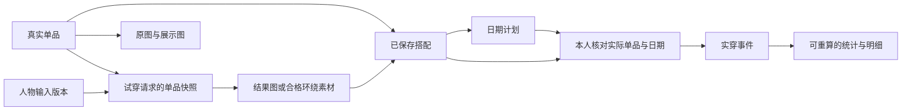

# 衣物需求、领域模型与统计口径

本文件描述业务职责与统计规则，不规定数据库表或接口结构；具体技术方案在需求确认后另行评审。

更新：2026-10-13。定义衣物档案、人物输入、试穿结果与实穿统计之间的业务边界；字段为需求合同，不是新建数据库或重写现有接口的指令。CL 条目均为建议，P0/P1 定义见需求入口。

## 0. 衣服相关需求

**衣服可以被录入，不等于模型已经支持试穿；识别到一件衣服，也不等于用户真实拥有它。**

| ID    | 范围            | 需求与字段                                                                     | 规则及验收                                                                                                                                   |
| ----- | --------------- | ------------------------------------------------------------------------------ | -------------------------------------------------------------------------------------------------------------------------------------------- |
| CL-01 | P0              | 物理身份：item ID、owner、名称、category、revision                             | 同款两件建立两个 ID；换图不新增衣物；同一物品可属于多个搭配                                                                                  |
| CL-02 | P0              | 分类：上衣、下装、连衣装、外套、鞋、包、配饰、其他/待确认；子类可后补          | 分类用于找衣，穿着位置用于组合；衬衫既可内搭也可作外搭，不由类别强行决定唯一角色                                                             |
| CL-03 | P0 基础/P1 叠穿 | 组合角色、层次、保留区域与试穿支持能力                                         | 基础每位置至多一个明确替换；分体与连衣装冲突先确认；外套在上衣外，开放/闭合等穿法未验证前不承诺                                              |
| CL-04 | P0              | 照片：原文件、净化展示图、处理版本、来源、主图；P1 增加背面/细节图             | 原图可追溯；抠图不丢图案边缘；初版 JPG/PNG/WebP、单文件≤12 MiB 且≤24MP，沿用现有上传上限；超限先本地缩放或说明；HEIC 解码列 P1，不能静默失败 |
| CL-05 | P0 可选字段     | 主色/辅色、图案、版型、袖长/衣长、品牌、尺码文本、材质、季节、场合、保暖、备注 | 不强迫填满；未知为空；自动建议保留来源和确认状态；照片不能可靠推断防水、成分比例或真实厚度                                                   |
| CL-06 | P1              | 实测尺寸与来源：肩宽/胸围/腰围/衣长/裤长等，单位与测量方法                     | 衣物尺码≠人体尺寸；品牌 M 不统一换成 cm；参考尺码表≠本人实测；不能据此自动保证合身                                                           |
| CL-07 | P0              | 所有权、当前可用性与生命周期分别表达                                           | 自有/参考分开；洗涤/外借/收纳不改变拥有身份；归档不抹历史；P1 借入支持时排除自有库存分母                                                     |
| CL-08 | P1              | 购买日期、金额/币种、购买来源、存放位置、洗护说明                              | 价格未知与 0 分开；不根据图像编造洗护要求；洗护标签照片可作为来源                                                                            |
| CL-09 | P0              | 属性与图片纠正、相似项提示、历史快照                                           | AI 不覆盖已确认字段；相同图片不强制合并；修正当前分类不重写历史记录中的名字/组合快照                                                         |
| CL-10 | P0              | 资产来源：实拍、本人提供商品图、识别衍生、生成示例、第三方授权预设             | 示例不自动进入真实衣橱；生成“商品图”标识衍生；收藏参考时必须明确是否真实拥有                                                                 |

### 录入与试穿支持矩阵（建议，不是当前能力声明）

| 输入/品类                            | 基础管理与实穿记录         | 人物试穿首轮建议                   | 未支持时                           |
| ------------------------------------ | -------------------------- | ---------------------------------- | ---------------------------------- |
| 无图但已命名单品                     | 支持                       | 不支持                             | 说明需要清楚衣物照片，允许补图     |
| 清楚正面上衣/下装                    | 支持                       | 分别验证单件替换；不是一次换整套   | 保留输入、给拍照要求               |
| 连衣装                               | 支持                       | 后续单独测试，不能用上衣测试代替   | 手动搭配和记录可用                 |
| 外套＋内搭                           | 支持                       | P1；遮挡、层次与开合需独立验收     | 不退回成脱掉内搭的错误结果         |
| 鞋、包、首饰等配饰                   | 支持                       | 暂不承诺替换；原图对应区域应保留   | 清楚显示“可选入搭配，暂不支持试穿” |
| 条纹/文字/大图案、蕾丝/透明/反光面料 | 支持                       | 作为挑战集，未通过不得列为支持范围 | 保留原图，输出不冒充精确材质       |
| 多人合照、多件重叠、人物穿着商品图   | 可保存资料；确认物品后入库 | 先裁剪/确认目标；自动拆件为 P1     | 不猜测所有权和背面结构             |

建议拍摄指导：单件完整、光线均匀、背景有对比，保留领口/袖口/下摆与明显图案；可先手机上传，再补细节。输入不合格应具体说明遮挡/模糊等原因，不要求所有用户达到摄影棚标准。

## 1. 核心对象

| 对象                 | 职责                              | 关键关联与边界                                                    |
| -------------------- | --------------------------------- | ----------------------------------------------------------------- |
| WardrobeItem         | 一件真实物理衣物                  | 稳定 item ID、owner、类别、可用性、生命周期、属性版本             |
| OutfitVersion        | 某次确定的衣物组合                | 有序/分角色单品清单与快照；编辑组合得到新版本                     |
| OutfitPlan           | 日期/场合的打算                   | 引用组合版本；active/cancelled/not_worn；本身不计实穿             |
| WearEvent            | 本人确认的一次实际穿着            | local_date、IANA time_zone、来源、部分/完整、revision             |
| WearEventItem        | 一次实穿关联的单品及当时快照      | event 与 item 唯一关系；外部/未知单品不得虚构真实 item ID         |
| WearFeedback         | 实穿后的舒适度与偏好              | 关联实穿事件；无反馈不影响次数                                    |
| PersonSource         | 本人原照或授权预设的版本          | owner/来源授权、照片版本、裁切/方向；预设不代表本人身体           |
| TryOnRequest         | 一次明确提交的试穿意图            | 人物输入版本、选择版本、替换角色/保留区域、幂等标识；阶段见 05    |
| LookAsset            | 一份结果图/环绕素材或合格 3D 资产 | request、素材形式、来源、质量结果、实际输入清单；不得自动创建实穿 |
| StatisticsProjection | 从有效实穿事实聚合                | 可重建；不作为手工修改次数的唯一真相                              |

衣物照片包括原图与可选展示图，关联同一真实单品；补换图、裁剪和抠图不新建物理衣物，也不更改实穿记录。上述对象表达业务职责，不要求一对象一张表；计划和实穿的快照应保留当时已确认内容。

试穿结果绑定人物与衣物的固定版本。请求结束后才修改衣物照片，不改变旧结果代表的输入；生成错误也不能倒改真实单品属性。原照中的未关联裤子/鞋可以是保留区域，但不虚构物品 ID。环绕素材与静态结果必须引用同一 Look 版本；不匹配时不给出同套结果的假象。

图片哈希可以帮助发现重复素材，不能替代真实单品身份。同件衣物换图不新增物品，同款两件也不能因共用图片而合并；确认真实单品才建立对应关联。

## 2. 穿着次数与天数：首版建议合同

**主指标“已记录穿着次数” = 指定范围内，与该单品关联的有效实穿事件数。**

**辅指标“穿着天数” = 上述事件的去重本地日期数。**

同一天早上通勤、晚上聚会，如果用户确实分别记录两次事件，同一件衣物计 2 次、1 天。采用按事件计数的业务口径，界面同时提供天数，避免用户误以为“一天永远只有一次”。若只是同一次穿着连续经过多个场合，应编辑原事件备注，不拆出次数。

统计不是传感器对真实世界的完整观测。UI 使用“已记录穿着”，不能将漏记解释为没穿或宣称衣物一生真实总次数。照片识别可以提出建议，只有本人确认才成为实穿事实。

### 统计资格

有效事件指本人明确提交、日期不晚于其所选时区的今天、未删除/撤回、属于当前用户的实穿事件。计划、推荐曝光、收藏、图片处理、照片草稿、取消计划、未穿计划不计入。

部分记录里明确选择的单品仍计数；未知单品不计到任意已有衣物。同一 event 中同一个物理 item 最多出现一次。不能给整套内每个视觉图层各加一次。

### 基本公式

设 E 为用户在闭区间 [from_date, to_date] 内的有效实穿事件，I(e) 为其中实际关联的真实单品集合：

- 单品次数：wear_count(i) = |{e ∈ E : i ∈ I(e)}|。
- 单品天数：wear_days(i) = |{e.local_date : e ∈ E 且 i ∈ I(e)}|。
- 实穿事件总数：|E|，不是所有单品次数之和。
- 已记录穿着日期数：|{e.local_date : e ∈ E}|。
- 最近穿着日期：max(local_date)，同日用稳定事件顺序展示；无记录则空值。
- 组合重复次数：按规范化组合身份/版本规则汇总，不把图片数量当作搭配数量。

正式实现使用唯一约束或集合语义去重；COUNT(*) 只有在 event-item 唯一性成立时才等价于上述公式。

## 3. 衣橱数量与结构

| 指标         | 拟议口径                                               | 注意事项                                              |
| ------------ | ------------------------------------------------------ | ----------------------------------------------------- |
| 当前衣橱总数 | 当前拥有且未归档的物理 item 数                         | 同款两件计 2；愿望单与参考图片不计                    |
| 可穿数量     | 当前衣橱内 availability = wearable                     | 洗涤/外借/打包分别显示，不假设都可用                  |
| 历史/归档数  | 曾有记录的归档物理 item 数                             | 不与当前衣橱重复混算                                  |
| 类别占比     | 当前衣橱中该类别数量 / 当前衣橱总数                    | 分类未知独立桶；总数为 0 时不画假百分比               |
| 颜色分布     | 每件选择一个主色，未知单列                             | 多色标签可用于筛选，但不能重复算件数                  |
| 期间使用覆盖 | 当前衣橱中在期间至少有一次有效记录的 item / 当前衣橱数 | 标签写清“当前衣橱”；归档历史另看，不混用期末/期间分母 |
| 低频单品     | 在选定窗口已记录次数较低的当前单品                     | 不是已经证明闲置；季节、购入时间与漏记有影响          |
| 从未记录穿着 | 系统记录范围内次数为 0                                 | 不能标为“一次没穿过”                                  |

建议窗口：近 7 天、30 天、90 天、自定义、全部已记录历史。排行榜显示窗口，同次数按最近日期及稳定 ID 排序，保证翻页一致。新增不足窗口长度的衣物标识观察期短，避免直接贴“闲置”标签。

## 4. 价格与每次穿着成本（P1）

- 单品购买价为可选十进制金额 + 币种；未知为空，赠品确认零价可为 0。
- 记录期每次成本 = 当前用户确认的购买价 / 全部**已记录**穿着次数；不是价格除以仅本月次数，除非单独明确标签。
- 从未记录穿着显示“暂无”，不能除以零；未知价格显示“价格未填”。
- 相同币种汇总衣橱金额；不同币种分别显示。未引入有日期和来源的汇率时，不进行隐式换算。
- 金额统计显示“已填价格 X/Y 件”，不得用部分价格冒充全部衣橱价值。
- 购入前的事件/价格冲突需要用户核对，不自动篡改历史。历史价格更正更新派生成本，穿着事实不变。
- 首版不计洗护费、转售价、通胀或环保减排。后续另行定义，不让简单成本指标承担财务建议。

无可靠日期的“以前大概穿过 20 次”如后续引入，只能独立保存为历史估计基线，不能生成 20 条伪造实穿或混入精确日期统计；P0 不提供直接编辑总次数入口。

## 5. 日期、补录与时间

1. 事件保存 YYYY-MM-DD 本地日期和 IANA 时区，如 Asia/Shanghai；created_at/updated_at 使用 UTC，二者职责不同。
2. 补录按实际穿着日期进入统计，而不是按录入日期；补录 10 月 9 日记录在 10 月 11 日提交，仍属于 9 日。
3. 未来日只能保存计划，不能提交实穿；根据事件所选时区判断“今天”，旅行时要显示所选时区。
4. 更改账户时区不静默平移历史 local_date。用户可显式纠正某条记录，revision 增加并重算。
5. 无精确发生时间时只记录日期，不补 00:00 来伪装真实发生时刻；同日顺序可用创建时间/ID，不能据此推断早晚。
6. 日期区间首尾均包含；内部查询可转换为半开区间，但 UI 与 API 语义要一致。
7. 未记录日期显示“无记录”；只有用户明示未穿某个计划，才显示该计划未穿。

## 6. 防重、纠错与删除

### 操作幂等与业务重复分开

- **幂等**：同一用户 + mutation ID + 相同操作内容返回同一结果；同 ID 不同内容返回冲突。客户端双击、超时重试不新建事件。
- **业务重复**：新 mutation ID 但同日同单品组合可能是误录，也可能是实际二次穿着。提示已有记录并允许用户选择编辑或明确新增，不能统一按“日期+组合”唯一拒绝。
- 防重不能仅靠按钮 disabled。服务端约束与事务必须覆盖并发。

### 更改与归档

编辑原事件使统计按新关联集合重算。例如旧记录含 A/B，改为 A/C，则 A 次数不变、B 减一、C 加一。删除/撤回有效事件后，其贡献移除；P0 不强制新增可恢复软删除，但要明确删除结果。

归档单品不删除历史事件。当前衣橱结构减少，归档历史次数仍可查询。永久删除的语义需在实施前固定：保留匿名快照且解除 item 引用，或随明确范围删除历史；不得保留指向不存在 item 的伪统计。账号全部删除明确衣物、记录与媒体的清理范围。

## 7. 核对数据集

以下均为虚构 ID，日期位于 Asia/Shanghai，价格示例为 CNY。

| 事件 | 日期       | 单品                   | 性质                 |
| ---- | ---------- | ---------------------- | -------------------- |
| E1   | 2026-10-09 | A 白衬衫、B 裤子、C 鞋 | 有效实穿             |
| E2   | 2026-10-09 | A 白衬衫、D 半裙、C 鞋 | 本人确认的另一次实穿 |
| E3   | 2026-10-10 | A 白衬衫               | 有效部分记录         |
| P1   | 2026-10-11 | B 裤子、C 鞋           | 仅计划               |
| D1   | 2026-10-11 | A 白衬衫的新展示图     | 仅修改照片           |

预期：A = 3 次 / 2 天，B = 1 次 / 1 天，C = 2 次 / 1 天，D = 1 次 / 1 天；实穿总事件 3、记录日期 2。P1/D1 均不增加统计。A 购买价 ¥300 时，每次已记录成本 ¥100。

- E2 同 mutation 重试：结果不变。
- E2 改为 A/B/C：A=3、B=2、C=2、D=0；总事件仍 3。
- 在该修改之后删除 E1：A=2、B=1、C=1；日期仍 2。
- 另开基线，归档 A：A 历史仍 3 次/2 天，当前衣橱总数减 1，历史事件仍 3。
- E3 在 11 日补录：仍归 10 日；变更账号时区后原记录不漂移。
- 新建同日同组合且明确二次穿着：事件数可增加，天数不增加。

以上应作为后续数据库与 API 的验收用例，不能只验证界面展示字符串。
