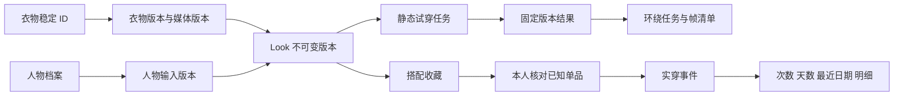

# WEARLOG 首版技术实现方案

更新：2026-10-13。状态：**基于已推送代码的实施提案，尚未接入真实生成**。代码基线为 server `f1fe12fb7b0886ec8e1e94e211a0a93b9e263fcb`、app `3a612356f3817a4a221a6573600bc75c0dc307ce`；CI 及文档复核见 [交付记录](../validation/main交付与文档复核.md)。本文件负责技术取舍、改造点与依赖；业务定义沿用 [需求入口](../requirement/README.md) 及 03～06，不新建第二份 PRD。

## 1. 产品目标决定实现顺序

用户来这里是为了判断“我的这件衣服换上后怎么样”。人物应占据主视觉，选衣与对比是核心操作；衣橱录入和实穿统计支持这个决定。完整 Woo 目标包含连续拖动查看，静态试穿只是验证阶段，不能擅自取消环绕。

建议采用：**现有真实衣橱 → 私人人物与固定版本 → 限定品类单件静态试穿 → 比较与账户 Look → 明确实穿及明细 → 已接受 Look 的按需环绕**。先通过效果门槛再接完整生成闭环；环绕素材合格后再优化查看器。每个阶段保留失败回退，手动衣橱和实穿不依赖生成服务。

| 用户需求           | 必须成立                                     | 实现落点                                  | 验收              |
| ------------------ | -------------------------------------------- | ----------------------------------------- | ----------------- |
| 用自己的衣服       | 真实单品 ID、原图/展示图、全库搜索、可用状态 | wardrobe、media；GarmentPicker 接账户查询 | AC-01/03          |
| 同一人物换一件     | 人物与输入固定；只替换支持部位，其他区域保留 | person 版本、Look 草稿、generation 适配器 | AC-02/04/05       |
| 看清变化           | 当前任务结果与原基线配对；旧结果明确标记     | LookComparison 接真实私有媒体             | AC-05/06          |
| 收藏以后再用       | 无日期收藏、账户持久化、可恢复清单           | 新 Look 领域与版本；不借用日期计划        | AC-07/11          |
| 知道真正穿过多少次 | 只在本人确认时写实穿；可纠错并反查           | 复用 wearevent，补单品明细查询            | AC-07/08          |
| 像 Woo 一样拖动看  | 合格连续源素材、方向连续与设备表现           | 独立环绕任务、私有视频/帧清单、查看器     | AC-13             |
| 失败后能继续       | 不丢草稿、不盲目重提、不伪装完成             | 既有任务状态/未知提交/清理及前端恢复      | AC-03/04/09/10/12 |

## 2. 已有代码能复用什么

| 层       | 保留的技术与职责                                                                        | 当前缺口                                                    |
| -------- | --------------------------------------------------------------------------------------- | ----------------------------------------------------------- |
| Web      | Next.js App Router、React、TypeScript；Server Component 默认，交互局部 Client Component | 首页三个示例单品未接真实账户衣橱；本人照仅本地预览          |
| UI       | shadcn/Radix、Tailwind 语义 token、Lucide、Geist；无边框紧凑设计，蓝色仅品牌            | 需要按真实任务补等待/未知/旧结果/保存失败；不再重做设计体系 |
| 请求     | TanStack Query、唯一 Axios 入口、运行时 OpenAPI → Umi 生成客户端                        | 新 person/Look/统计合同需要先从 Go 定义并重新生成           |
| 服务端   | Go + Gin/Huma + GORM + PostgreSQL，现有模块化单体                                       | 补业务模块及适配；不重建调度平台或独立全栈应用              |
| 媒体     | 私有 MinIO、固定对象版本、Worker 校验、本人读取和撤销                                   | 外部处理授权、生成输入衍生图、Look/视频关系和清理覆盖       |
| 生成     | 输入快照、幂等、预约、租约、未知提交、结果校验、清理                                    | bootstrap 只有 fixture；视频类型和真实衣物输入还不支持      |
| 衣物整理 | U2netp + ONNX Runtime Web 本地抠图/裁剪，原图与展示图分存                               | 小模型边缘仍需用户检查；不承担试穿或属性事实判断            |
| iOS      | SwiftUI、Observation、GRDB，保留现有本地数据身份                                        | 当前仅同步品牌；个人 API、云端 Look 与生成另定切片          |

Vercel/Geist 指导视觉与 Web 体验；shadcn 提供组件源码。它们不要求替换 Go 后端，也没有规定业务必须叫 `tryon`。Web 继续按 `components/<business>`、`hooks/<business>`、`lib/<business>` 和 `layout` 组织，基础控件归 `components/ui`；实际命名和依赖方向以 [PROJECT](../../PROJECT.md) 为准。[Geist 官方入口](https://vercel.com/geist/introduction)

## 3. 数据关系与版本

以下是待评审的最小设计，不是已存在的表或发布 API。

- **WardrobeItem**：现有物品身份不变。换图、抠图、归档不换 ID、不改变实穿；补拥有/参考/演示属性时，不能把现有 `wardrobe/quick_add` 来源枚举当拥有权。未知属性保留为空。
- **Person / PersonVersion**：记录 owner、来源（本人/授权预设）、media ID 与固定对象版本、授权引用及 revision。预设素材也需明确使用权，不能因为在设计稿中出现就视为可商用。
- **Look / LookVersion**：Look 是可复用搭配，不要求日期；版本冻结人物、明确单品 ID/revision、照片版本、目标替换部位和保留区域。未知原裤鞋只记录为视觉保留区域，不伪造衣橱单品。
- **GenerationJob / Output**：复用既有任务与产物，关联 Look 的确切版本；选择变更创建新草稿，不改运行中任务输入。技术完成与视觉接受分开；模型返回文件不能直接意味着用户满意。
- **OrbitAsset**：引用已接受的静态结果版本；记录源视频、后处理版本、封面、有序帧/方向映射、尺寸、SHA 与对象版本、质量结论。背面由模型推断时明确标记。
- **WearEvent**：继续作为唯一实穿事实。补可选的 Look 来源版本用于追溯；不要求先生成日期计划。确认时再核对衣物可见性、日期/时区和已知单品，支持部分记录。

并发写使用 expected revision；保存与实穿各自使用稳定 mutation/idempotency ID。重试同一写入返回原结果，不能多建收藏或多记一次。修改 Look 不回改历史实穿快照。归档保留历史；删除时按既有可追溯/清除策略处理，不用外键级联把记录静默抹掉。

## 4. 最容易低估的生成合同缺口

### 4.1 衣橱图片不能直接塞进生成任务

现有 [生成输入校验](../../backend/internal/adapter/postgres/generation.go) 要求 `generation_input` 用途、JPEG、本人有效同意、固定 hash 和就绪状态；garment 角色要求 `ordinary_image`。现有衣物照片是 `wardrobe_image`，还可能是透明 PNG/WebP。因此“接上 API”前需要明确转换与授权流程。

建议保留原衣物/原图，在用户明确试穿时生成受控的 **生成输入衍生媒体**：记录 source media ID、对象版本、处理参数与 hash；仅对需要的输入做格式/尺寸适配，并取得对应处理方、区域、用途和保留期的授权。不得改写衣橱媒体用途来绕过校验，不把本地开发授权当作外部供应商授权。允许重用同版本衍生物，但不得跨账户去重。

实际上传继续沿用 `/media/uploads` → 私有签名 PUT → `/media/{id}/complete` → Worker 验证 → ready。原图/净化展示图/生成输入分别表达。当前上限是 **12 MiB、24MP**；CL-04 已与此统一。模型入口可设更小的尺寸限制，必须在提交前说明，不破坏衣橱的录入能力。

### 4.2 任务框架有基础，真实 provider 没有接入

现有 [bootstrap](../../backend/internal/bootstrap/generation_workers.go) 只接 `generationfixture`。静态试穿先选一条经过 G2 的路线，才增加真实适配器；服务端能力清单控制可选模型、部位、输入与预算，客户端不能任意指定收费模型或参数。

复用现有提交、观察、结果 Worker 的职责：提交只负责外部任务身份；观察映射供应商状态；结果阶段把产物写入私有对象存储，校验格式、大小、hash 和 lineage 后才成为可访问技术结果。第三方下载链接只作为短时输入，不保存到 Look 作为长期图片地址。

既有状态 `queued/running/validating/succeeded/failed/canceled/expired` 保留；`submission_state=unknown` 与取消请求单独表达。未知提交必须按外部请求标识查询/核对，不能自动再次发起收费请求。取消后可能仍产生费用或迟到文件，界面显示真实状态，撤销读取与后台清理分别完成。

### 4.3 现有合同没有视频

[HTTP 合同](../../backend/internal/adapter/httpapi/generation_contract.go) 和 [持久化产物](../../backend/internal/adapter/postgres/generation.go) 当前只接受 `image/model` 与 `image/jpeg/model/gltf-binary`。环绕不能塞进 `model` 字段。要扩展 purpose、输入 lineage、MIME/大小/时长、授权、额度、结果校验、导出与清理的整条合同，并配套数据库迁移及旧数据回归。

`confirm-image` 目前只是确认生成图片，不等于创建账户搭配。不要把 `look_id` 字段存在误判为已有 Look 仓储。

## 5. 真实效果路线怎么选

| 路线                            | 能解决的事                         | 本项目采用条件                                                     |
| ------------------------------- | ---------------------------------- | ------------------------------------------------------------------ |
| 专用静态 VTON                   | 人物图＋单品图生成上身效果         | 先比较身份、衣物和未换部位；通过 G2 才接业务                       |
| 已接受 Look → 环绕视频 → 图片帧 | 高质量像素展示及可拖动方向         | 一套先验连续性，合格才扩三套；不把每次换衣称为即时 3D 装配         |
| 人工/授权模块化人物与服装 GLB   | 几何连续旋转，预适配服装可快速换件 | 先取得符合质感的人物＋三件独立适配服装；测美术工时、穿模与手机性能 |

静态开源候选 FASHN VTON v1.5 的官方入口确实以人物图和衣物图为输入，输出二维图片，类别包含 tops/bottoms/one-pieces；它不是环绕或可穿 GLB 流水线。本次只重新读取官方仓库，不下载权重、不复跑。已有官方失败图与本项目证据边界见 [可行性研究](人物展示可行性.md)。不能据开源名或精选样例保证 Woo 质感。[官方源码与示例](https://github.com/fashn-AI/fashn-vton-1.5)

视频可沿用户已选的火山方舟/BytePlus Seedance 方向评估；仍缺当前账户可用模型、区域、请求合同、价格和实际输出。当前 Codex 会话没有可调用的原生视频生成入口；不能以文档计划冒称已解决。在可用入口、数据政策和硬预算明确前不运行付费试验。官方动态页面本次读取失败，未新增模型 ID 或报价；既有核查入口见可行性研究。

真正 3D 的显示机制成熟，质感瓶颈在人物、头发、皮肤、服装制作与适配。单张照片缺背面/内侧/厚度，自动生成整套 GLB 不会自动得到可换的独立服装。当前 img2threejs/程序体块样例已失败，不继续堆精修；只有拿到合格资产及授权，再以同人物三件衣服对照验证。成本未知时不租 GPU 或预制全部搭配。

## 6. 环绕展示的落地约束

先验证源视频完整一周、方向无倒退/切镜、首尾、身份与衣纹稳定，再抽帧。时间等距抽帧不代表角度等距，应检查转速，必要时记录实际方向映射；错误源片不能靠补帧变成合格人物。

建议首版先评估一条水平环绕轨道。鼠标/触摸拖动映射帧索引，键盘提供左右方向及复位；不宣称自由上下俯仰。默认封面，只有用户打开环绕才加载当前 Look。预取邻近方向，限制解码帧缓存；退出/换 Look 时终止请求并释放位图、Canvas 和 object URL。不全量解码所有收藏。

内存估算：`768×1024×4×72` 字节约 **216 MiB**，三套约 648 MiB，仅计解码像素，未含浏览器/GPU 副本。下载压缩体积不能代替内存预算。帧数按连续性与设备测量选择，不先承诺 72 帧或某 FPS。

固定缓存身份至少含 owner、PersonVersion、LookVersion、输入媒体版本/hash、模型及参数/后处理版本。私有素材访问校验、撤销与过期覆盖整条链；不能为速度改为 public 静态目录。视频失败时保留已接受正面，显示失败与回退，不将离散四视图标为 360° 成功。

## 7. 接口与页面按业务切片补齐

以下路径为**建议设计**，正式合同以 Huma 及运行时 OpenAPI 为准，不手改生成客户端。

| 切片     | 现有入口                                     | 待补合同与页面行为                                                                         |
| -------- | -------------------------------------------- | ------------------------------------------------------------------------------------------ |
| 衣橱     | `/wardrobe/items`、媒体上传/私有读图         | 服务端 q/category/状态分页；归档恢复入口；查询只加载首页不能冒称全库搜索                   |
| 人物     | 本地照片预览；已有媒体基础                   | person 档案/版本及授权预设清单；上传成功并 ready 后才能作为任务输入                        |
| Look     | 浏览器示例草稿、日期计划                     | `/looks`、版本读取/更新、收藏/取消收藏；owner 隔离、幂等保存、媒体失效保留清单             |
| 试穿     | `/generation-jobs` 及详情/取消/删除/产物读取 | 服务端解析 Look 版本和能力，固定任务意图；刷新后恢复，未知先查，旧结果不覆盖新草稿         |
| 实穿     | `/wear-events` 的增查改删                    | 可选 Look 来源版本；默认只列已知真实衣物；部分记录和重复核对，保存收藏不计数               |
| 单品统计 | 已有范围统计与年度摘要                       | owner-scoped 单品次数、distinct 本地日期天数、最近日期、分页明细；同一过滤口径，可反查纠错 |
| 数据控制 | 账号删除、媒体删除、导出基础                 | 衣物原/展示/生成输入、人物、Look、任务/环绕关系进入导出与删除范围；缺图明列                |

统计从有效实穿事件与关联重算；不维护前端点击累加器。高频查询先确认索引与 SQL 计划，确有瓶颈再做可重建聚合，PostgreSQL 仍为事实源。04 的 A/B/C/D 核对集覆盖同日多次、补录、改件、删除及归档。

前端继续复用 `FittingRoomView`、`PersonPreview`、`GarmentPicker`、`LookComparison`。业务请求放各域 hooks；图片渲染只接数据，不在展示组件隐式读取 fixture 或账户存储。TanStack Query 处理服务端状态，本地只存可恢复草稿/任务 ID；账户切换清理或隔离私人草稿，不把图片 Base64 长期放 localStorage。

## 8. 实施顺序、门槛与可并行内容

| 顺序              | 最小交付                                           | 前置与完成证据                                 | 未通过时                                |
| ----------------- | -------------------------------------------------- | ---------------------------------------------- | --------------------------------------- |
| T0 输入和实验合同 | 一人物三衣；支持部位、评价表、实际预算、数据政策   | 复用现有材料；真实用户观察与 G2 条件齐备       | 只继续文档和无付费 UI，不扩生成         |
| T1 效果可行性     | 单件静态每输入首轮一次、至多一次有原因重试         | 按 G2 全量记录；人物/目标衣物/保留区域逐项接受 | 关键失真重复出现即停；不得只展示精选图  |
| T2 真实输入与版本 | person、Look 草稿、真实选衣及生成输入衍生图        | 不依赖付费可先定义合同；真正接模型须 T1 通过   | 保留衣橱/手动记录，阻止无效提交         |
| T3 真实任务与对比 | 一个 provider、恢复/取消/未知/旧结果、真实私有产物 | T1＋T2；AC-02～06/09/10/12 故障注入与实际服务  | 不发布真实试穿入口                      |
| T4 收藏与实穿明细 | 账户 Look→明确实穿→单品反查；导出删除补关系        | 可先做无生成收藏；完整候选需 T3，AC-07/08/11   | 不以本地名称草稿替代账户收藏            |
| T5 连续环绕       | 一套合格源片→拖动；通过后另外两套                  | 已接受静态结果；单独预算；AC-13 与真机资源记录 | 回到静态验证版，完整 Woo 目标不宣称完成 |
| T6 内测           | G1、G2、完整适用 AC/NFR，持续观察复用              | 若作为完整 Woo 目标交付必须包含 T5             | 收缩支持范围或返回前阶段                |

T0/T1 期间可以做真实衣橱查询、Look 数据设计和手动业务验证；不要提前批量生成素材、部署多模型或做完整 GPU 平台。工期需效果与合同明确后估算，不能以单张图生成时间推导项目日期。

## 9. 质量、成本与发布证据

需求 05 的 NFR 是待测目标：普通请求限定规模 p95≤500ms；冷加载人物/内容 p75≤3s；选择反馈 p95≤100ms；静态生成 p95≤60s 暂定。按指定硬件、网络、样本数测量，不能从本机一次成功外推。真实 iPhone Safari、Android Chrome、键盘和 200% 文字分别测试；无设备就标未测。

每个实验/任务保留 request/attempt/外部任务身份、输入版本、排队/推理/后处理/人工/总时间、技术状态、视觉结论、拒绝原因、估算/账单/未知费用及币种。重试、弃用、人工修图都进分母；unknown 不记成零，credits 不和货币直接相加。接受数为零只报告总投入，不算单份成功成本。

发布检查分四层：静态/单元与架构 → 真服务及故障恢复 → 实际浏览器/设备 → 人物衣物视觉接受与用户任务。CI 全绿证明前面的工程检查，不证明后面的 Woo 质感。新 person/Look/video 采用增量迁移、旧数据计数和关系核对及恢复演练，不更改 iOS bundle ID、数据库目录或稳定媒体/会话标识来追求命名整齐。

尚需确认：首批招募、支持品类与输入条件、视频可用入口及模型、可接受等待/费用、供应商区域/保留/训练政策，以及环绕交付批次。已确认的衣序品牌、无边框紧凑样式、单件替换主线和环绕目标不重复讨论。本次不调用生成、不采购、不部署 GPU；新增实现按上述门槛另行推进。
