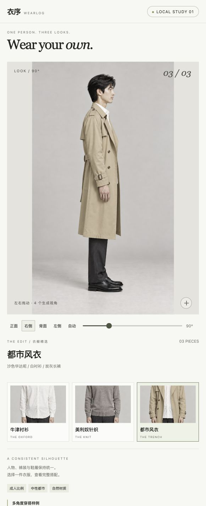

# Codex 多视角样例

记录整理：2026-10-12。复用同日另一阶段已生成的结果，本次只归档证据，未新增生图。此样例与 [人物实验汇总](人物展示验证汇总.md) 中早期批次不同，不能混算调用。

## 实际结果

同一虚构成人男性，白衬衫、灰褐针织、沙色风衣三种 Look；每套正、右侧、背、左侧共 4 张，最终查看器使用 12 张。全部来自 Codex 原生 image_gen，**没有视频、GLB 或连续 3D**。角度是目标标签，没有相机标定。

此前浏览器已实际验证方向按钮、拖动侧面至背面、保留背面换风衣/针织、放大恢复与生成记录弹窗。截图保存如下；截图本身不能替代互动证明。

2026-10-13 已清理旧查看器与本地原素材目录，原 8796 地址不再作为运行入口。查看器、提示词、台账与全部 15 张原图已移入本机可恢复归档，位置见 [文档入口](../README.md)。以下保留历史实测证据，不表示当前产品已实现连续旋转或任意单品试穿。

## 质量判定与失败

针织初版 3 个侧背角度出现明显伪纹理并被弃用，各重做一次。重做后仍有裤装纹理漂移；风衣腰带和衣摆也跨视角变化。最终 12 张中 6 张针织/风衣侧背图仍带一致性问题；**不能用 12/15 宣称 80% 质量通过率**。脸部、衣服的大致观感可评审，但 Woo 质感与连续性均未通过。

| 证据                                                                 | 说明                                          |
| -------------------------------------------------------------------- | --------------------------------------------- |
| [针织初次侧面](assets/codex-multiview-20261012/knit-90-rejected.png) | 实际弃用，仍计入资源消耗                      |
| [针织重做侧面](assets/codex-multiview-20261012/knit-90.png)          | 保留作预览，不能认定严格保真通过              |
| [风衣背面](assets/codex-multiview-20261012/coat-180.png)             | 腰带/衣摆需与其他方向核对；背部细节为生成推测 |

衣物也是生成示意，未使用用户真实上传服装验证还原；缓存整套 Look 的切换不等于任意单品实时上身。四方向存在跳转，插帧和淡入淡出不能凭空修复跨视角款式错误。未测真实手机冷加载、内存与大量 Look，也没有真实环绕视频成功率。

## 投入台账

| 指标                    | 记录值                                            |
| ----------------------- | ------------------------------------------------- |
| 图片请求                | 15 次（含 3 次重做），全部返回图片                |
| 工具请求耗时合计        | 401 秒，即 6 分 41 秒；不是全流程或纯模型推理时间 |
| 技术失败                | 0 次                                              |
| 视觉弃用                | 3 张；其余仍不等于用户验收通过                    |
| 视频任务 / 外部付费调用 | 0 / 0                                             |
| 实际金额                | null，工具未暴露账单；已有 Codex 额度不等于零成本 |

[逐次记录](assets/codex-multiview-20261012/generation-log.json) 保存提示词、时间、质量备注，移除了机器上的生成来源绝对路径；其中历史 videoQuote 只是当时未执行的报价，不能作为当前价格。完整原图 SHA256 与大小见 [素材清单](assets/codex-multiview-20261012/asset-manifest.json)。只复制有代表性的证据，避免在仓库重复保存全部大图。
