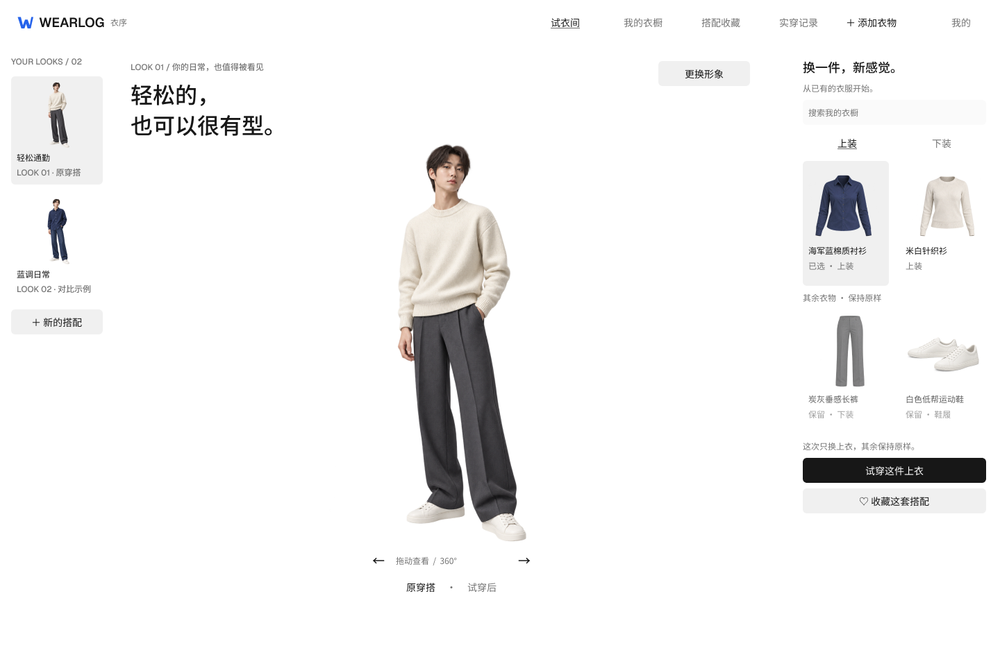
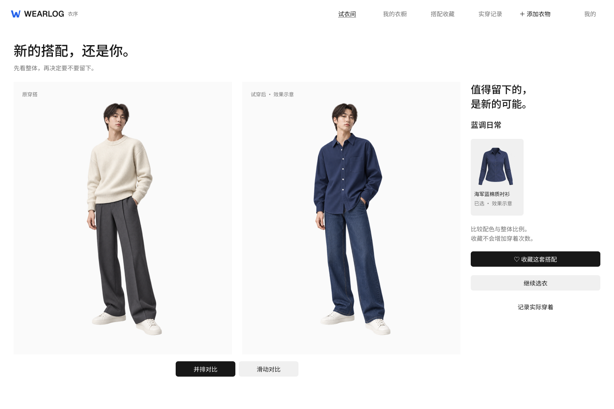

# 衣序 / WEARLOG Figma 设计验收

日期：2026-10-13。正式品牌为衣序 / WEARLOG。本记录维护当前设计入口、原型和素材边界；旧稿网页已不可用，历史截图仍保留于原验证目录。设计可点击不代表真实试穿、持久 Look 或业务计数已接通。

## 当前入口与方向

- [可编辑设计](https://www.figma.com/design/fYWIHuNucsMQBNYzXBPuEq/?node-id=5-4)
- [桌面原型](https://www.figma.com/proto/fYWIHuNucsMQBNYzXBPuEq/?node-id=5-4&starting-point-node-id=5%3A4&scaling=scale-down)
- [手机原型](https://www.figma.com/proto/fYWIHuNucsMQBNYzXBPuEq/?node-id=8-133&starting-point-node-id=8%3A133&scaling=scale-down)
- [品牌规范](https://www.figma.com/design/fYWIHuNucsMQBNYzXBPuEq/?node-id=9-944)

在 Chrome 重新观看用户提供的 [Woo 视频](https://www.douyin.com/video/7663795599515088357)。采用其人物展台、窄 Look 栏、直接选衣与无边框布局；标题进入展台，完整成人比例人物作为中心。保留 Vercel/shadcn 中性控件，蓝色仅用于 W 品牌图形。没有复制对方 Logo、虚构用户记录或将截图当作整页 UI。

桌面为 1440×960，手机为 390×844。2026-10-13 最新更正为无边框紧凑版：桌面导航 64px、操作控件 36px、标题 32/44；左右栏收至 164px 和 304px，人物展台 972px。手机标题 24/34、导航 56px，保留 44px 点击区域。默认描边与阴影移除，选中状态仍有浅底和文字，蓝色只用于品牌。共 27 个可编辑审阅画板：桌面 16 个（含状态规范）、手机 10 个、品牌 1 个。另有共享控件、Header 和素材源，不把它们算作产品页面。

## 画板与产品任务

| 用户任务 | 桌面节点 | 手机节点 |
| --- | --- | --- |
| 人物展示与单件选衣 | `5:4` | `8:133`、`8:161` |
| 前后对比 | `7:38` | `8:205`、`12:463` |
| 衣物管理与录入 | `7:89`、`7:254` | `8:231` |
| 收藏与详情 | `7:146`、`7:186`、`9:670` | `8:270` |
| 实穿列表、确认与成功 | `7:219`、`9:731`、`12:395` | `8:301`、`17:636`、`12:437` |
| 登录、注册与设置 | `9:627`、`9:647`、`7:299` | 共用业务合同，独立手机版设置后续细化 |
| 生成中与失败 | `9:795`、`9:850` | 主线对比示意，不模拟真实推理耗时 |
| 导航 | 桌面共享 Header | `14:784` |
| 异常与恢复规范 | `9:905` | 复用相同业务语义 |
| 品牌 | `9:944`，组件 `4:2` / `4:5`，图标 `9:941` | 同一标识 |

状态规范覆盖照片不合格、保存失败、提交未知、同日相似记录、衣物不可用、统计读取失败、额度不足、旧结果与新选择不同、记录版本变化。照片和选择保留，提交未知先查原任务，统计失败保持未知而不是零；收藏和预览不计实穿，记录必须明确确认。

## 结构与验证

- 新建变量基础：中性表面、文字、边界、品牌色、间距、圆角；语义色绑定 primitive，具有明确 scope 和 Web code syntax。
- Button、Input、GarmentCard、LookTile、Brand、桌面 Header 与手机 Header 均使用组件和实例；文字保持可编辑，图片为独立内容素材。
- 核心原型已接通选衣、试穿示意、对比、收藏、详情、实穿确认与手机导航。Chrome 实际点击进入生成示意并跳转对比；这是原型，不是生成服务验收。
- 无边框紧凑版 27 个画板均重新导出检查；可编辑后代含 558 个文字、323 个实例与 63 个图片矩形。字体为 Geist 与 Noto Sans SC，默认描边为 0，原型连接 117 条，最终布局越界为 0。组件缩窄后的尺寸继承、手机已选文字与对比卡片说明换行已修正。
- [全部画板检查图](assets/wearlog-redesign-20261013/review-contact-sheet.png)。单页 PNG 与节点清单保存在同目录。

## 能力与实施边界

人物与衣物复用已存在的设计示意素材，没有新生图、视频或付费调用。图片仍为正面，360° 控件表达目标交互，不能证明连续环绕已交付。历史对比图同时改变了上衣和裤子，标为效果示意，单件真实结果仍待验证。

Web/iOS 已同步品牌、工程名称和图标。当前 Web 已实现无边框试衣间、选衣和前后对比主线，生产浏览器回归 15/15，详情见 [页面验收](试衣间页面验证.md)。这不代表全部 27 个画板已完整工程化，旧布局的测试不能抵扣新增任务验收。真实供应商、成本、持久 Look、冷加载、真实手机和辅助技术仍按需求 AC/NFR 单独验收。

