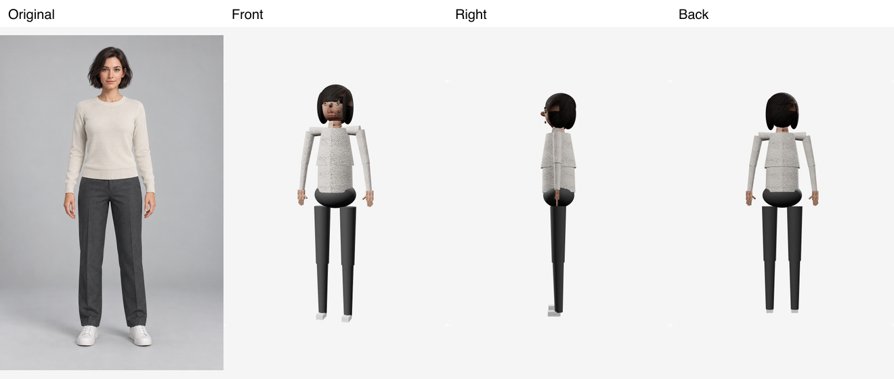

# 人物展示验证汇总

整理：2026-10-12。本文件替代逐轮重复的 9 份人物实验记录，保留实际结果、失败、时间与费用。下表为此前 2026-10-11～12 的记录归并，**本次没有重新生成或重跑模型**。路线决策统一见 [人物展示可行性](../research/人物展示可行性.md)。

## 已有结果与投入

| 实验                                 | 实际结果与失败                                                                                           | 记录耗时                                                                                          | 费用与调用边界                                                                                                                        |
| ------------------------------------ | -------------------------------------------------------------------------------------------------------- | ------------------------------------------------------------------------------------------------- | ------------------------------------------------------------------------------------------------------------------------------------- |
| 首批 Codex 编辑（原 13）             | 5 次成功返回图片，身份大致保持；非目标裤装仍被重绘，严格保真未通过                                       | 5 次工具请求合计 221.296 秒                                                                       | 金额未暴露；Seedance 凭据预检失败 1 次，远程视频任务 0                                                                                |
| 独立单品 + 低模骨架（原 17）         | 3 次新图仍改纽扣/下摆/裤鞋；独立部件切换与 4 个关键帧动作能运行，但低模质感、穿模与脚滑不合格            | 新图 158.690 秒；流程窗口 499.049 秒，口径不同不相加                                              | 前后两批共 8 次图片请求、379.986 秒；不得把累计数再次计费；实际金额未知                                                               |
| 二维分层骨骼（原 18）                | Canvas 换件保持素材像素/动作相位；转向跳变、侧行重影、关节折纸感、遮挡缺图，视觉未通过                   | 一次 atlas 生图 57.280 秒；完整窗口 16 分 53 秒                                                   | 没有外部付费调用；Codex/机器/人工费用未知                                                                                             |
| Tripo 两版人物（原 21）              | 初版手臂异常，A-pose 改善，Studio 能播放动作；没有两件衣服适配；GLB 导出被付费门槛阻挡，未导出           | 初版生成/减面/绑骨 173.599/109.402/92.148 秒；A-pose 259.618/113.761/139.188 秒；流程 26 分 18 秒 | 两版各 55+5+20，共 **160 Studio credits**；余额 200→40，未购买订阅；不能换算为 API 美元价。另一次 Codex A-pose 图 51.648 秒，金额未知 |
| MPFB/MakeHuman（原 23）              | 修复首次取景裁掉上身后得到可旋转 GLB；默认脸/材质质感被否决                                              | 完整窗口 11.70 分钟；初次构建 197.034 秒，修正流程 15.297 秒                                      | 新购买/API/新生图 0；本机与人工成本未知                                                                                               |
| Blender Studio Rain（原 24）         | 精细度改善但比例、眼睛仍卡通；输出是静态资产，无蒙皮/动画，不是原人物还原                                | 完整窗口 13.79 分钟；三次处理 183.6 秒不等于全部制作时间                                          | 无新购买/API；代码与模型授权分开，Rain 需 CC BY 4.0 署名                                                                              |
| Three.js 灯光与扫描头（原 28）       | 实际网格旋转、光照与法线对照有效；Rain 仍卡通，扫描头闭眼、缺头发/完整身体，未达到写实成人全身           | 完整窗口 15.81 分钟                                                                               | 无新生成/购买；Rain CC BY 4.0，Lee Perry Smith 扫描 CC BY 3.0                                                                         |
| Codex 原图与 Tripo 对应核验（原 29） | 确认相同输入与 Studio 模型对应，本地能载原图；导出缺口仍在，不算同人物本地 3D 交付                       | 未单独记录完整窗口，不补造                                                                        | 余额仍 40 credits；新生成与支付 0                                                                                                     |
| img2threejs（原 30）                 | 官方程序化 blockout 可转动；脸/头发/衣服/体型与原图差距明显。修复黑贴图后仍差，停在 blockout，无细化换装 | 展示窗口 21.3 分钟；含修复记录合计 **24.8 分钟**，不能相加                                        | 新外部付费调用 0；Codex/本机实际金额未知                                                                                              |

另一个独立会话的 15 次图片生成不包含在前几批累计数里，见 [Codex 多视角样例](Codex多视角样例.md)。不同实验的窗口有代码制作、等待和复核，不能直接累计为供应商推理时间或生产单套工时。

## 可以证明与不能证明的内容

真实网格旋转说明 Three.js 显示机制可用，不能证明低质量输入会变成写实人物。Rain 导出约 10.27MB、17 个 mesh、22 材质、77,034 三角形，**0 skin、0 animation**；MPFB GLB 为 25,409,252 字节。这些大小不是质量评分或手机性能证据。Three.js 实验采用 0.186.1、WebGL2、GLTFLoader/OrbitControls 与 PBR/ACES/PMREM；更换渲染 API 不解决脸、头发和服装资产质量。

img2threejs 样本有 27,960 三角形、64 draw calls。轮廓诊断 IoU 0.2562、纵横比差值 0.485，说明该输入的形状匹配失败；它们不是人脸相似度。可移植的原图与失败结果：

同输入核对的原图为 1024×1536，SHA256 `746ae99547245bc0cb7849c05fa359d2b857a580ee25a5e0a211242fa46a2e31`。它用于排除“拿不同人物比较”，不证明模型侧背真实。

最早 FFmpeg 测试使用 `testsrc2` 工程彩条，384×512、3 秒，两套各 36 帧；106/83ms 抽帧只证明命令管线。二维骨架录屏是实际 Canvas 录屏，也不是 AI 环绕源片。二者不能填补真实人像视频缺口。

## 证据保留和恢复

2026-10-13 已将旧人物实验页面、组件、生成与验证脚本，以及 `.tmp` 下的人物模型、分层骨骼、对比与展示目录移出工作区，移除专用 Three.js 依赖。当前 checkout 不再提供 `/appearance-lab` 入口。

代表性失败图、逐次生成台账、素材哈希与本汇总继续保留。旧实现、原始素材、模型许可与清理前文档保存于本机可恢复归档，位置见 [文档入口](../README.md)。恢复时只取所需文件到新临时目录；历史记录不构成新生成授权。费用未知继续保留未知，不将“没有新付款”改写为免费。
