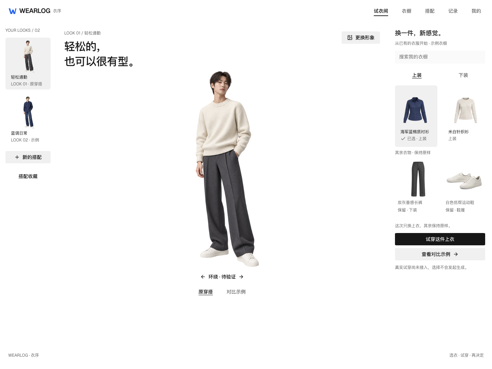
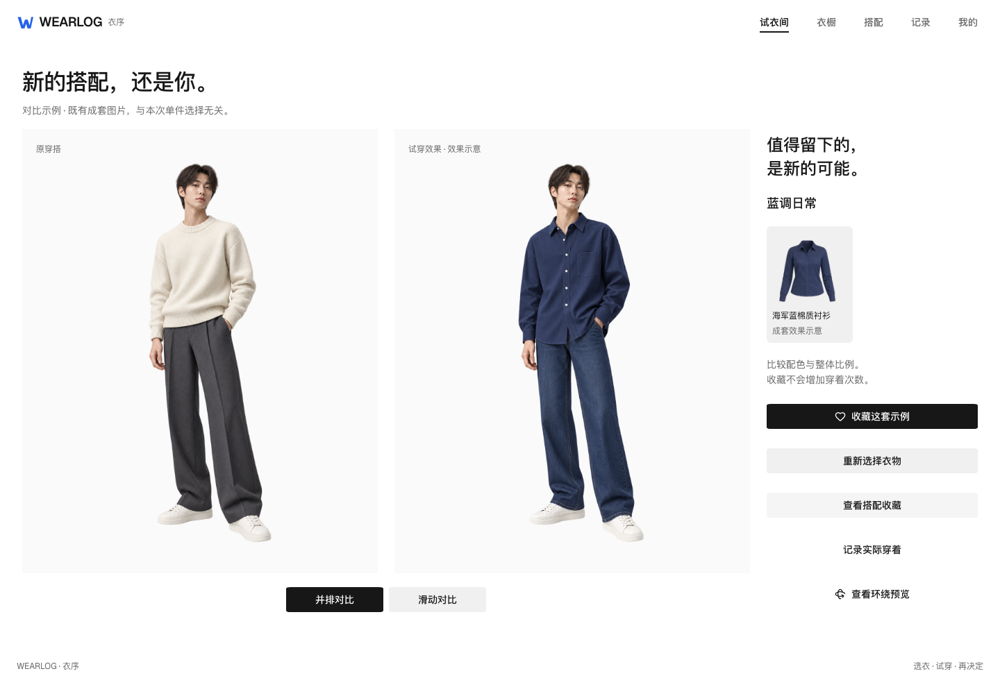

# 无边框试衣间页面验证

日期：2026-10-13。对象是当前 `frontend/` 工作区的本地生产构建，未提交、推送或执行远程 CI。预览地址为 `http://127.0.0.1:3100/`。本记录原地替代旧布局验收，历史截图仍保留；不将本次主线实现写成全部 Figma 画板或真实生成已完成。

## 设计依据与范围

以 [最新版 Figma 桌面试衣间](https://www.figma.com/design/fYWIHuNucsMQBNYzXBPuEq/?node-id=5-4)、对比 `7:38`、手机 `8:133` 的实时设计上下文与截图为目标，读取根 DESIGN、PROJECT、前端 AGENTS 和已安装 Next.js 文档。使用已有 shadcn radix-nova / Radix、Tailwind v4、Geist 与系统中文回退，图标来自已配置的 Lucide；没有增加依赖、导入完整 UI 截图或手画图标。

本次完成桌面人物展台、窄 Look 栏、直接选衣和搜索、手机选衣 Sheet，以及并排/滑动/手机切换对比。共享 Header、字标、语义字号和基础控件同步紧凑无边框样式；蓝色仍只在 W 品牌资源中。其他业务页面继续沿用现有功能，不虚构第二套收藏或真实穿着记录。iOS 只同步共享 DESIGN，未修改客户端页面。

桌面控件实际命中区域仍至少 44px，通过透明上下边界与背景裁切表达 36px 可见表面；手机保留 44px。焦点轮廓、错误文字与已选标记保留，未以去边框为由隐藏状态。响应式人物高度根据可用视口变化，完整呈现成人比例，不固定整页像素坐标。

## 工程职责核对

进一步使用 Vercel 插件的 React Best Practices 技能与官方 Next.js 文档核对：原 `TryOnView` 是试衣页面名称，不是额外服务、官方组件或 Vercel 规定的目录；现收敛为 `FittingRoomView`。`GarmentPicker` / `GarmentOptions` 独立接收数据，预览未接入的状态与行动由页面管理。对比使用模块级 next/dynamic 并提供加载状态，路由入口继续保持 Server Component。遵守现有工程目录与 shadcn 组合，未新增组件库、API 或监控依赖。

原人物素材迁到 `public/look-samples`；衬衫、牛仔裤复用已有逐字节相同的衣橱图片，运动鞋保持原素材。仅删除已验证重复的副本，未重新生成、缩放或替换照片。已有 `wearlog.try-on.sample-draft.v1` 与历史品牌键保持原样，避免目录更名导致草稿丢失。浏览器用例已更名 `fitting-room.spec.ts`；原验收截图路径保留用于证据追溯。调整后 lint、类型、格式、生产构建、21 项单元/架构测试和完整 15 项生产浏览器回归均通过。

官方依据：[Next.js 项目组织](https://nextjs.org/docs/app/getting-started/project-structure)、[按需加载](https://nextjs.org/docs/app/guides/lazy-loading)、[Vercel Geist](https://vercel.com/geist/introduction)。未执行性能基准，不宣称具体包体积或速度改善。

## 用户行为与实现边界

- 上衣与下装保持单件互斥选择；搜索名称/颜色不清空当前选择，无结果使用 Empty 并提供清除入口。手机选衣使用 SheetTrigger/asChild，确认与 Escape 后恢复焦点。
- 原图保持原样；保留衣物是展示说明，不自动入库或增加次数。点击试穿说明服务未接入，保留选择且不发送生成请求。既有成套结果只通过“查看对比示例”入口呈现，明确与本次选择无关。
- 对比使用传入的 LookImage，不在共享展示组件中内置样例或存储。桌面 Slider 支持键盘和鼠标拖动，手机前后切换；环绕入口明确没有连续素材。
- 人物照片经过类型、大小与解码检查，仅本地 blob 预览。示例收藏继续使用已有浏览器草稿，支持刷新、旧键迁移和保存失败保留输入；不写入账户 Look 或实穿。
- 人物、衬衫、裤子、针织和鞋复用原素材。新增使用的针织/灰裤与 Figma 原始图逐字节 SHA256 相同，已记录到 `frontend/public/look-samples/assets.json`；所有内容图使用 next/image，不用图标贴图替代 Lucide。

## 验证结果

| 检查 | 当前结果与范围 |
| --- | --- |
| lint、类型、Prettier、生产构建 | 通过 |
| 单元/架构测试 | 21/21，含组件职责、目录依赖与展示组件不持有样例/存储 |
| 生产浏览器回归 | 15/15，23.9 秒（本次职责调整后的生产构建）；试衣主线 9 项，注册/认证与既有业务回归 6 项 |
| 搜索与选择 | 过滤、空态恢复、选择保留、方向键移动与空格确认、保留部位显示通过 |
| 对比与草稿 | 并排、键盘滑杆 50→51、鼠标拖动超过 70、手机切换、保存刷新、存储失败与旧键迁移通过 |
| 照片 | 加载失败重试、无效文件、本人照片仅本地、恢复示例人物通过 |
| 响应式 | 320、390、699、700、768、834、859、860、1023、1024、1199、1200、1400、1440px 的主线与对比无水平溢出；390px 的 200% 根字号通过 |
| 焦点与操作区域 | Sheet/Dialog/菜单关闭恢复、页面切换焦点通过；桌面主操作实际命中高度至少 44px |
| Chrome | 实际操作搜索、选衣、试穿状态、前后对比；截图见下方。自动回归使用独立 Chromium，不与 Chrome 人工证据混淆 |
| Git 与费用 | 原暂存内容逐字节未变；未提交/推送，未新增图片、视频生成或付费调用 |

第一次浏览器检查发现手机 Sheet 未恢复触发按钮焦点，已用 shadcn Trigger 与 Radix 关闭焦点事件修复；另外修正新版标题的空白、radiogroup 语义和方向键后以空格确认的测试。最终完整套件通过，没有放弃失败用例。API 响应受控的注册、衣橱与实穿回归不等于真实服务写入验收。

未验收真实供应商、连续 360°、账户 Look 服务、完整 27 个画板、实际手机/VoiceOver、移动网络冷加载或生产部署。人物正面 PNG 仍约 1.6MB，未用本次页面视觉验收抵扣性能目标。后端任务、数据库与媒体处理没有改动。

## 实际页面

[Chrome 实际试衣间](assets/try-on-20261013/borderless-implementation/chrome-room.png) · [Chrome 实际对比](assets/try-on-20261013/borderless-implementation/chrome-comparison.png)

[手机试衣间](assets/try-on-20261013/borderless-implementation/room-mobile.png) · [手机对比](assets/try-on-20261013/borderless-implementation/comparison-mobile.png) · [手机选衣](assets/try-on-20261013/borderless-implementation/mobile-clothing-sheet.png)
